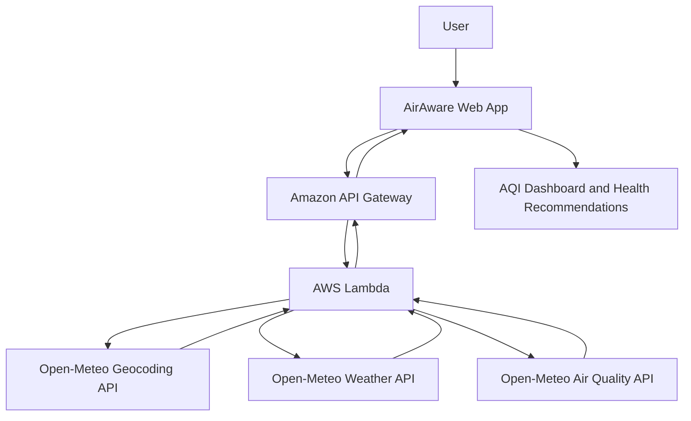

# airaware
AirAware 🌿 is a real-time environmental dashboard that provides air quality (AQI), PM2.5/PM10 levels, weather updates, UV index, and actionable health recommendations. Built for WeMakeDevs × AWS Environmental Hacks to promote smarter, healthier, and more environmentally aware living.

link - https://air-aware-environmental-safety-dashboard--bhuvanpno123.replit.app/

## 🏗️ System Architecture

AirAware uses AWS Lambda and API Gateway to retrieve live environmental data from Open-Meteo APIs.

